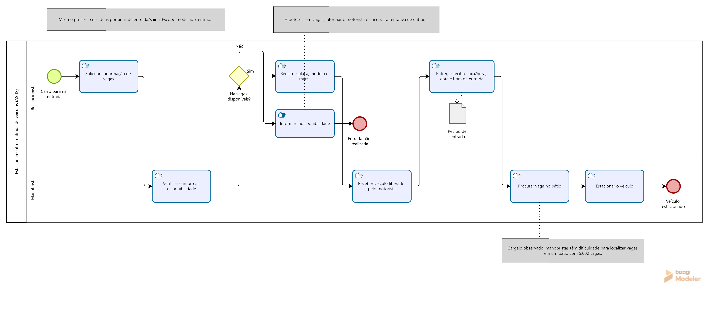
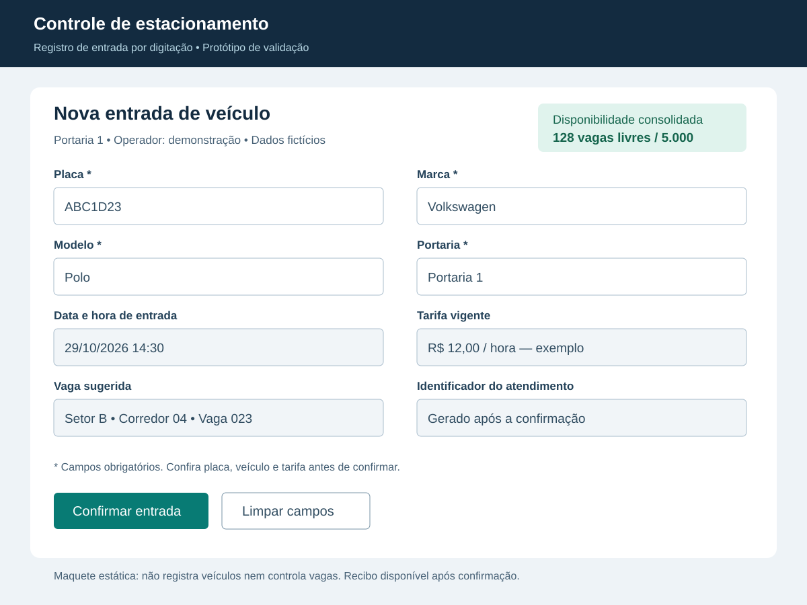
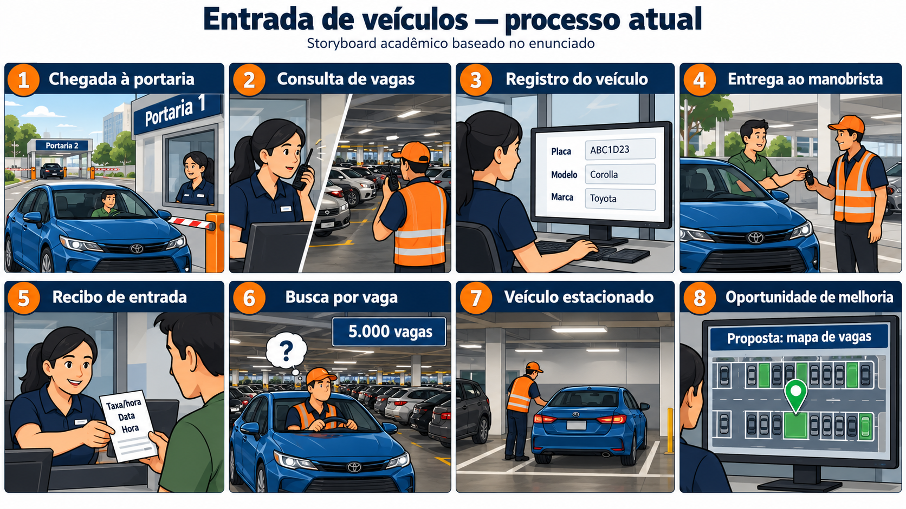

# Projeto Estacionamento

Este repositório reúne a pesquisa de mercado, a entrevista, a modelagem do processo, o protótipo de entrada e o storyboard do projeto.

## Conteúdo

- [Pesquisa de mercado](#pesquisa-de-mercado)
- [Entrevista](#entrevista)
- [Modelagem BPMN](#modelagem-bpmn)
- [Protótipo de entrada](#protótipo-de-entrada)
- [Storyboard](#storyboard)

## Pesquisa de Mercado

Foi realizada uma pesquisa nos sites oficiais de quatro soluções de controle e automação de estacionamentos disponíveis no mercado brasileiro. O objetivo foi identificar funcionalidades que possam orientar o levantamento de requisitos do projeto.

### Soluções analisadas

| Solução | Principais funcionalidades |
|---------|----------------------------|
| **CloudPark** | Controle de entradas e saídas, cálculo automático de cobrança, gestão em nuvem, leitura de placas, integração com cancelas e totens de pagamento, reserva de vagas online e integração com Sem Parar. |
| **Jump Park** | Registro de entradas e saídas por aplicativo, configuração de tarifas e convênios, gestão de mensalistas, controle de pagamentos, relatórios, emissão de nota fiscal, leitura de placas por foto e registro de avarias com imagens. |
| **WPS Brasil** | Controle automatizado de acesso, integração com cancelas e terminais, reconhecimento de placas, gestão do estacionamento, pagamento por celular, carteiras digitais e autoatendimento. |
| **MCPark** | Operação sem dependência da internet, acompanhamento remoto pelo módulo web, controle de vagas, módulo antifraude e integração com Sem Parar, máquinas de cartão e Pix. |

### Análise para o projeto

O controle de entradas, saídas e pagamentos aparece como uma necessidade recorrente nas soluções pesquisadas. Recursos como reserva antecipada, reconhecimento de placas e autoatendimento ampliam a automação e podem facilitar a experiência do cliente.

Com base na pesquisa, foram identificados os seguintes recursos para avaliação no levantamento de requisitos:

- **Controle de veículos:** registrar entradas, saídas e tempo de permanência.
- **Controle de vagas:** acompanhar a ocupação e a disponibilidade.
- **Cobrança automática:** calcular valores conforme tarifas e regras cadastradas.
- **Pagamentos:** oferecer diferentes formas de pagamento e emitir comprovantes.
- **Gestão de mensalistas:** controlar cadastros, contratos e vencimentos.
- **Relatórios:** consultar movimentação, ocupação e faturamento.
- **Automação de acesso:** integrar leitura de placas e cancelas.
- **Reserva online:** permitir a reserva de vagas antes da chegada.

Esses recursos são possibilidades para o projeto e deverão ser priorizados conforme as necessidades identificadas nas entrevistas com os usuários.

### Fontes

- [CloudPark](https://www.cloudpark.com.br/)
- [Jump Park](https://www.jumppark.com.br/)
- [WPS Brasil](https://wpsbrasil.com/)
- [MCPark](https://softwareparaestacionamento.mcpark.com.br/)

> As funcionalidades foram identificadas a partir das informações divulgadas pelos fornecedores. A disponibilidade pode variar conforme o plano, os módulos contratados e os equipamentos integrados.

Arquivo original: [Pesquisa de mercado](Pesquisa%20de%20mercado).

## Entrevista

Perguntas e respostas sobre as expectativas do consumidor de um estacionamento, conforme o arquivo publicado no repositório.

**1. Quais informações você precisa consultar antes de escolher um estacionamento?**
Preço, localização, horário de funcionamento, segurança e disponibilidade de vagas.

**2. Quais dificuldades você costuma encontrar ao utilizar um estacionamento?**
Filas na entrada e saída, falta de vagas e demora no pagamento.

**3. Como gostaria de consultar a disponibilidade de vagas antes de chegar?**
Por um aplicativo ou site que mostre as vagas disponíveis em tempo real.

**4. Em quais situações seria útil reservar uma vaga antecipadamente?**
Em dias de eventos, horários de pico ou compromissos importantes.

**5. Como gostaria de receber a confirmação de uma reserva?**
Por WhatsApp ou e-mail, com um código de confirmação.

**6. O que tornaria a entrada no estacionamento mais rápida e prática?**
Reconhecimento automático da placa do veículo e abertura automática da cancela.

**7. Como gostaria de ser orientado para encontrar uma vaga disponível?**
Por placas indicativas ou sinalização visual mostrando as vagas livres.

**8. Quais necessidades específicas de vaga o estacionamento deve atender?**
Vagas para idosos, pessoas com deficiência, gestantes, motos e veículos maiores.

**9. Como você gostaria de consultar os preços e as regras de cobrança?**
Por uma tabela clara na entrada e disponível no aplicativo ou site.

**10. Durante a permanência, como gostaria de acompanhar o tempo estacionado e o valor a pagar?**
Por um aplicativo que atualize automaticamente o tempo e o valor acumulado.

**11. Quais formas de pagamento você gostaria de utilizar?**
Pix, cartão de crédito, débito e dinheiro.

**12. Como gostaria de receber o comprovante de pagamento?**
Digitalmente, por WhatsApp ou e-mail, com opção de impressão.

**13. Que tipo de aviso seria útil receber durante o uso do estacionamento?**
Avisos sobre tempo de permanência, valor acumulado e encerramento da reserva.

**14. O que facilitaria encontrar seu veículo ao retornar?**
Um registro da localização da vaga, identificado por setor e número.

**15. O que tornaria a saída do estacionamento mais rápida e prática?**
Pagamento antecipado e liberação automática pela leitura da placa.

**16. Caso perdesse o ticket ou tivesse um problema na cobrança, como gostaria de solicitar ajuda?**
Por atendimento presencial ou WhatsApp, utilizando a placa para localizar o registro.

**17. Quais informações sobre a segurança do estacionamento você gostaria de conhecer?**
Existência de câmeras, vigilância, controle de acesso e cobertura de seguro.

**18. Se utilizasse o estacionamento frequentemente, o que esperaria de um plano mensal ou programa de fidelidade?**
Descontos, pagamento mensal fixo, facilidade de acesso e benefícios para clientes frequentes.

**19. Quais recursos de acessibilidade você precisa para utilizar o serviço com autonomia?**
Vagas acessíveis, rampas, sinalização adequada e opções de atendimento acessíveis.

**20. Entre as melhorias mencionadas, quais três seriam mais importantes para você?**
Reconhecimento automático de placas, consulta de vagas em tempo real e pagamento digital.

Arquivo original: [Entrevista](Entrevista).

## Modelagem BPMN

O diagrama representa o processo atual de entrada de veículos, com raias para Recepcionista e Manobristas, consulta de disponibilidade, registro do veículo, entrega do recibo e estacionamento. O gargalo de localização de vagas está destacado no modelo.

- [Abrir a imagem do diagrama](Modelagem.jpg).
- [Baixar o modelo editável do Bizagi](Modelagem.bpm).

## Protótipo de entrada

Maquete da tela de registro de entrada por digitação, com placa, marca, modelo, portaria, data e hora, tarifa e vaga sugerida. Os valores exibidos são dados de demonstração.

[Visualizar ou baixar o protótipo em SVG](Prototipo-entrada.svg).

## Storyboard

O storyboard apresenta oito etapas: chegada à portaria, consulta de vagas, registro do veículo, entrega ao manobrista, recibo de entrada, busca por vaga, veículo estacionado e oportunidade de melhoria com mapa de vagas. As sete primeiras cenas mostram o processo atual; a última apresenta a proposta de melhoria.

[Visualizar ou baixar o storyboard](Storyboard.png).
